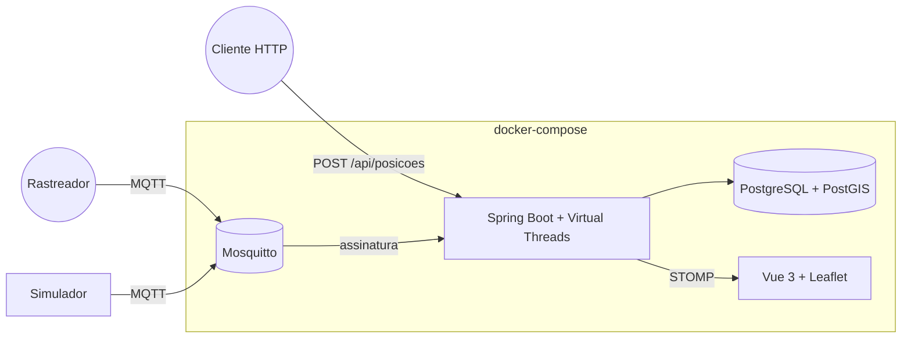

# monitoramento-de-frota

Painel que acompanha veículos em tempo real no mapa, guarda o histórico de trajetos e dispara alertas quando um veículo entra, sai de uma cerca virtual ou excede a velocidade permitida.

## Funcionalidades

- Recebimento de posições por **MQTT** (um tópico por dispositivo, `frota/{dispositivoId}/posicao`) e por **API HTTP** — os dois caminhos compartilham a mesma lógica de negócio
- Mapa em tempo real via **WebSocket/STOMP**: cada posição nova e cada alerta chegam ao navegador assim que acontecem, sem polling
- Cercas virtuais (polígonos) com três modos de alerta: entrada, saída ou ambos, e limite de velocidade opcional por cerca
- Alertas de entrada, saída e excesso de velocidade, gerados por **transição** (não a cada posição dentro da cerca)
- Histórico de trajeto por veículo, desenhado como linha no mapa
- Simulador que gera dezenas de veículos percorrendo rotas em loop e publicando via MQTT — prova o caminho de ingestão ponta a ponta sem precisar de hardware real

## Arquitetura



Os dois caminhos de ingestão (MQTT e HTTP) convergem no mesmo `PosicaoService.registrar(...)`: resolve ou auto-registra o veículo pelo `dispositivoId`, persiste a posição, avalia contra todas as cercas ativas e transmite o resultado por WebSocket. Nenhuma lógica de negócio é duplicada entre os dois protocolos.

A avaliação de cercas compara a posição **atual** com a **anterior** do mesmo veículo: um alerta de entrada ou saída só é gerado na transição (cruzar a fronteira), não repetido a cada posição recebida dentro da cerca. A checagem de contenção usa [JTS](https://locationtech.github.io/jts/) em memória sobre os polígonos já carregados pelo Hibernate Spatial — o PostGIS continua sendo a fonte de verdade da geometria (armazenamento + índice GiST), mas a checagem "quente" evita uma consulta espacial ao banco por cerca a cada posição.

## Stack

| Camada | Tecnologia |
| --- | --- |
| Backend | Spring Boot 3, Java 21 com **Virtual Threads** (`spring.threads.virtual.enabled` + processamento MQTT em `Executors.newVirtualThreadPerTaskExecutor()`) |
| Banco geográfico | PostgreSQL + **PostGIS**, Hibernate Spatial, JTS |
| Mensageria | MQTT (Eclipse Mosquitto, cliente Eclipse Paho) |
| Tempo real | WebSocket com STOMP (`spring-boot-starter-websocket`) |
| Frontend | Vue 3, Vite, TypeScript, Leaflet, Tailwind CSS, `@stomp/stompjs` |
| Documentação da API | springdoc-openapi (Swagger em `/swagger-ui.html`) |
| Testes | JUnit 5, Testcontainers (Postgres com PostGIS), Mockito, Vitest |
| Infra | Docker Compose, GitHub Actions |

## Como rodar

Pré-requisitos: Docker e Docker Compose.

```bash
cp .env.example .env
docker compose up --build
```

- Painel: http://localhost:8094 — o simulador já começa a mover ~30 veículos automaticamente
- API: http://localhost:8077 — documentação em http://localhost:8077/swagger-ui.html
- MQTT: `localhost:1883` (sem autenticação, apenas para demonstração — veja as decisões técnicas)

Para publicar uma posição manualmente via MQTT (ex.: com `mosquitto_pub`):

```bash
mosquitto_pub -h localhost -t frota/dispositivo-teste/posicao \
  -m '{"dispositivoId":"dispositivo-teste","latitude":-23.561,"longitude":-46.655,"velocidade":45}'
```

Ou via HTTP:

```bash
curl -X POST http://localhost:8077/api/posicoes \
  -H "Content-Type: application/json" \
  -d '{"dispositivoId":"dispositivo-teste","latitude":-23.561,"longitude":-46.655,"velocidade":45}'
```

As portas expostas no host podem ser ajustadas no `.env` caso já estejam em uso.

### Rodando os testes

```bash
cd backend
mvn verify   # testes unitários (avaliação de cercas) + integração (Testcontainers: Postgres com PostGIS)
```

```bash
cd frontend
npm ci
npm run test
npm run build
```

## Decisões técnicas

- **Virtual Threads em dois lugares**: no servidor web embutido (`spring.threads.virtual.enabled=true`, trivial de habilitar no Spring Boot 3.2+) e, de forma explícita, no processamento de cada mensagem MQTT recebida — o callback do cliente Paho roda numa única thread de rede interna da biblioteca, então nunca deve bloquear nela; cada mensagem é delegada a uma virtual thread, liberando o callback imediatamente.
- **Contenção geográfica em memória (JTS), não por consulta a cada posição**: as cercas ativas (poucas, no porte deste sistema) são carregadas uma vez por avaliação e a checagem `polygon.contains(ponto)` roda em Java puro. O PostGIS seria consultado diretamente (`ST_Contains`) se o número de cercas crescesse a ponto de a carga completa deixar de ser trivial — uma troca de escala documentada, não esquecida.
- **MQTT sem autenticação**: aceitável apenas para demonstração local. Em produção, o broker exigiria `password_file` ou certificados por dispositivo (TLS mútuo), e o tópico incluiria algum token de dispositivo validável.
- **Alertas de excesso de velocidade sem cooldown**: cada posição acima do limite dentro de uma cerca gera um novo alerta — não há deduplicação por janela de tempo. Para o porte de demonstração (intervalo do simulador de poucos segundos) isso é aceitável; um sistema de produção precisaria de um cooldown por veículo+cerca para não inundar o painel.
- **Reprodução de trajeto como linha estática**, não um controle de tempo animado: ao selecionar um veículo, o histórico das últimas 6 horas é desenhado de uma vez no mapa. Um scrubber de linha do tempo com reprodução quadro a quadro é uma evolução natural, mas não essencial para provar que o histórico é consultável.

### O que este projeto demonstra

Domínio de dados geográficos (PostGIS, JTS, índices espaciais), tempo real de verdade (WebSocket, não polling) e um recurso moderno do Java 21 (Virtual Threads) aplicado onde ele realmente importa — I/O de rede que não pode bloquear a thread do cliente MQTT.

## Roteiro (próximas evoluções)

- [ ] Relatórios de quilometragem, tempo parado e velocidade média
- [ ] Notificação de alertas por e-mail ou push
- [ ] App simples para o motorista enviar a posição pelo celular
- [ ] Previsão de chegada (ETA) por rota
- [ ] Reprodução de trajeto com controle de tempo (scrubber), não só a linha completa
- [ ] Cooldown de alertas de excesso de velocidade por veículo+cerca
